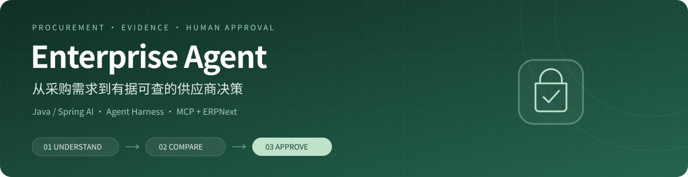
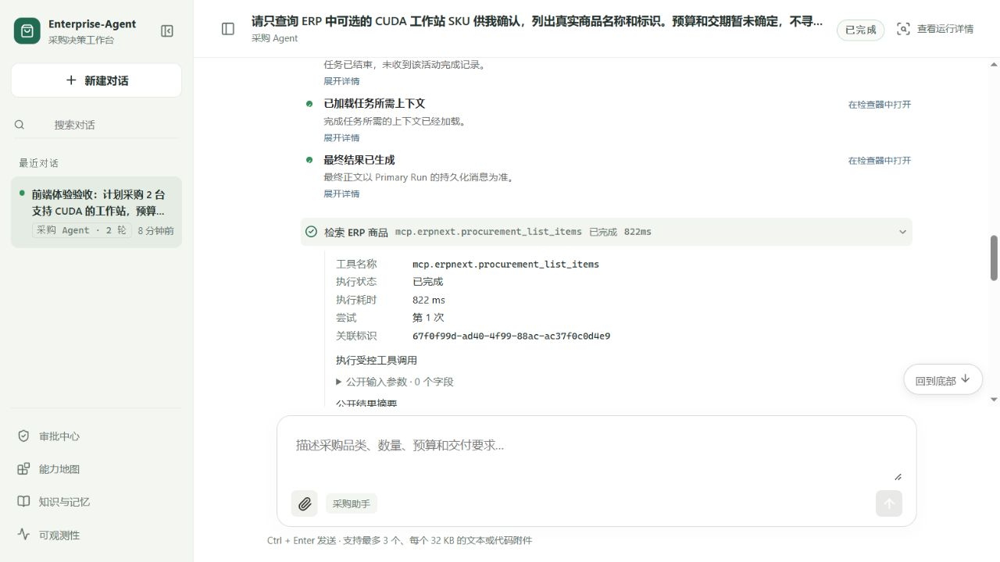
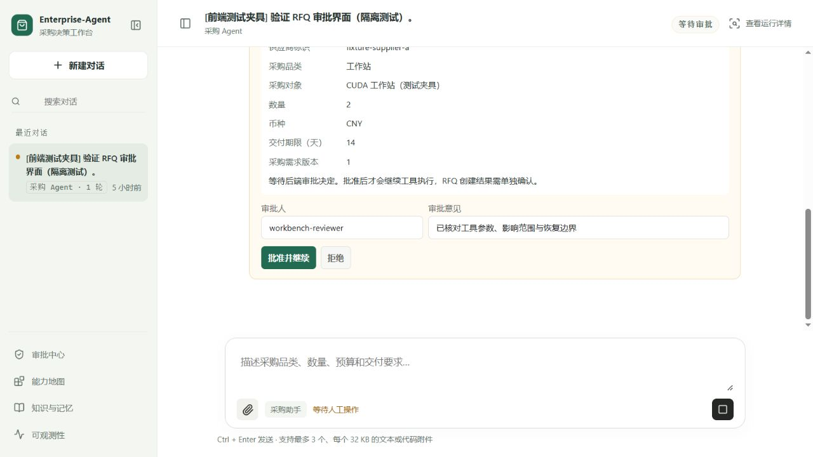
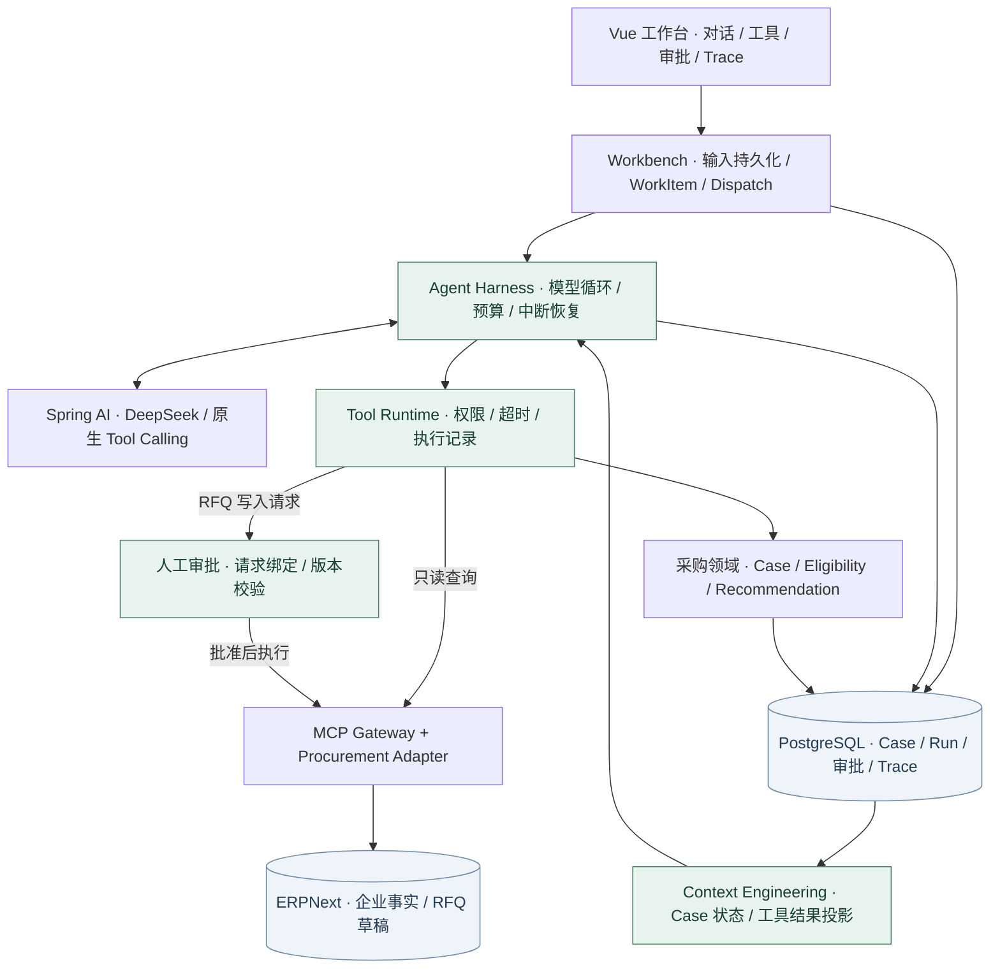

<p align="center">
  
</p>

<p align="center"><strong>理解需求 · 比较供应商 · 解释推荐 · 人工审批后创建 RFQ</strong></p>

<p align="center">
  
  
  
  
  
</p>

<p align="center">
  <a href="#overview">项目介绍</a> · <a href="#preview">界面预览</a> · <a href="#quick-start">快速开始</a> · <a href="#architecture">架构设计</a> · <a href="#docs">技术文档</a>
</p>

<a id="overview"></a>

## 让每一次采购，决策有据

**Enterprise Agent 是基于 Java / Spring AI 的企业采购 Agent 工作台。** 它将自然语言需求转为采购 Case，从企业数据中读取商品、预算和供应商事实，校验硬约束，生成带来源证据的推荐，并在人工批准后创建 ERPNext 询价单（RFQ）草稿。

模型负责需求理解与方案权衡，Java 负责业务校验、状态版本、执行预算和写操作授权。工作台将对话、工具调用、审批和运行轨迹放在同一条可追踪的任务链路中。

> **版本导航**：本页介绍的 ERPNext、Harness 和上下文工程实现位于 [`codex/procurement-workbench`](https://github.com/KunShengWang/enterprise-agent/tree/codex/procurement-workbench)。`main` 的业务代码仍是较早的采购基线；请按下方命令克隆开发分支。技术文档链接也指向该分支。

### 从一个采购需求开始

> “算法部门需要采购 2 台支持 CUDA 的工作站，总预算 5 万元，交期不超过 14 天。请比较可选供应商，说明推荐理由；创建询价单前先让我确认。”

| 步骤 | Agent 做什么 | 你能看到什么 |
| --- | --- | --- |
| **理解需求** | 澄清缺失信息，更新有版本的采购 Case | 数量、预算、交期与约束 |
| **查询事实** | 通过 MCP 读取 ERP 商品、部门预算、供应商与履约记录 | 工具调用、来源和返回结果 |
| **比较推荐** | Java 校验资格，Agent 解释价格与交付取舍 | 带证据引用的供应商推荐 |
| **确认执行** | 服务端重建请求，人工审批后创建 RFQ 草稿 | 审批内容、执行回执与运行轨迹 |

<a id="preview"></a>

## 界面预览

**在对话中查看工具执行与业务结果。** 工具详情按需展开，运行记录、审批和诊断信息可继续追溯。



<p align="center"><sub>真实后端 ERP 商品查询截图 · 2026-10-08 本地开发版本；截图中的界面改造尚未全部推送，远程分支布局可能不同。</sub></p>

<details>
<summary><strong>展开查看：RFQ 人工审批界面</strong></summary>



此图来自隔离前端测试夹具，用于展示审批交互，不代表一次真实 ERP 写入验收。批准后仍需依据后端回执确认创建结果。

</details>

## 核心能力

| 能力 | 实现方式 |
| --- | --- |
| **采购决策** | 需求澄清、Case Patch、供应商检索、硬约束校验与推荐 Finalize；推荐时重读权威状态并验证证据 |
| **统一 Agent Harness** | 基于 Spring AI 原生 Tool Calling，由统一 Runtime 管理模型与工具循环、预算、超时、取消和审批暂停恢复 |
| **上下文工程** | 每轮重读 Case，分离业务状态与工作上下文；对工具结果做结构投影与去重，保留证据、来源和原始审计记录 |
| **受控工具执行** | 区分只读、内部写入和外部副作用；对符合条件的只读瞬态错误进行有界重试，写入结果不确定时按幂等键查询 |
| **MCP + ERPNext** | 通过领域 Adapter 读取企业事实；RFQ 请求绑定审批、版本和摘要，批准后创建 ERPNext 草稿 |
| **可观测工作台** | 流式回答、工具详情、审批中心、Run 历史、Trace、预算与 SSE 断线重放 |
| **公共平台能力** | 保留 RAG、pgvector、Memory、Eval 与 AgentOps；各能力由执行 Profile 限定使用范围 |

**当前 ERPNext 路线采用单采购 Agent。** Legacy synthetic 路线保留可选的 Commercial / Delivery 专家分析；ERPNext Profile 关闭这两个子 Agent。公共 RAG / Memory 模块的存在，也不意味着采购运行会调用它们。

<a id="architecture"></a>

## 架构设计



- **业务事实有权威来源。** ERPNext 保存企业主数据；本项目保存 Case、推荐、审批和执行记录。模型输出不能覆盖来源事实。
- **写操作需要确定授权。** RFQ 根据服务端状态重建请求；审批绑定具体内容和版本，需求变化后不能沿用过期授权。
- **执行过程能够追溯。** 工作上下文可以压缩，原始工具结果、证据和运行记录仍然保留。

<a id="quick-start"></a>

## 快速开始

### 1. 获取当前实现

```bash
git clone --branch codex/procurement-workbench https://github.com/KunShengWang/enterprise-agent.git
cd enterprise-agent
```

需要 **JDK 17、Maven、Node.js 20.19+ 或 22.12+（含兼容的更高版本）、npm，以及专用开发 PostgreSQL 数据库**。RAG / Memory 向量能力需要 pgvector 和 Embedding 服务。ERPNext 演示另需 Docker Compose 与 PowerShell 7。

### 2. 配置开发环境

以下命令在仓库根目录的 **PowerShell** 中执行；先将占位值替换为自己的开发配置。数据库应已创建，并具备 pgvector 扩展。

```powershell
$env:DEEPSEEK_API_KEY = "<your-deepseek-api-key>"
$env:EMBEDDING_API_KEY = "<your-embedding-api-key>"

$env:AGENT_STORAGE_POSTGRES_URL = "jdbc:postgresql://localhost:5432/<dev-db>"
$env:AGENT_STORAGE_POSTGRES_USERNAME = "<dev-user>"
$env:AGENT_STORAGE_POSTGRES_PASSWORD = "<dev-password>"
$env:RAG_POSTGRES_URL = $env:AGENT_STORAGE_POSTGRES_URL
$env:RAG_POSTGRES_USERNAME = $env:AGENT_STORAGE_POSTGRES_USERNAME
$env:RAG_POSTGRES_PASSWORD = $env:AGENT_STORAGE_POSTGRES_PASSWORD
$env:MEMORY_POSTGRES_URL = $env:AGENT_STORAGE_POSTGRES_URL
$env:MEMORY_POSTGRES_USERNAME = $env:AGENT_STORAGE_POSTGRES_USERNAME
$env:MEMORY_POSTGRES_PASSWORD = $env:AGENT_STORAGE_POSTGRES_PASSWORD

$env:WORKBENCH_WEB_ENABLED = "true"
$env:WORKBENCH_ROUTING_ENABLED = "true"
$env:WORKBENCH_DISPATCH_ENABLED = "true"
$env:WORKBENCH_PROJECTION_ENABLED = "true"
$env:WORKBENCH_LOCAL_ROLES = "USER"
```

默认 Embedding 配置是智谱 `embedding-3`、1024 维。使用其他服务时，同时设置 `EMBEDDING_BASE_URL`、`EMBEDDING_PATH`、`EMBEDDING_MODEL` 和 `EMBEDDING_DIMENSION`，并确保与向量表一致。完整参数见 [application.yaml](https://github.com/KunShengWang/enterprise-agent/blob/codex/procurement-workbench/src/main/resources/application.yaml)。

### 3. 选择运行方式

| | Synthetic 演示 | ERPNext 演示 |
| --- | --- | --- |
| **适合** | 先体验采购交互与受控执行 | 演示企业数据接入与 ERP RFQ |
| **事实来源** | 仓库内合成数据 | 导入 ERPNext 的合成企业数据 |
| **RFQ** | 进程内模拟网关 | ERPNext `Request for Quotation` 草稿 |
| **启动** | `mvn spring-boot:run` | 按下方流程启动 ERPNext Profile |

<details>
<summary><strong>ERPNext 启动流程</strong></summary>

在完成第 2 步配置的终端中执行：

```powershell
pwsh -NoProfile -File tools/erpnext/manage.ps1 start
```

首次运行需下载镜像并初始化站点。等待 `create-site` 容器成功退出后执行 `health`；只有检查通过才继续：

```powershell
pwsh -NoProfile -File tools/erpnext/manage.ps1 health
pwsh -NoProfile -File tools/erpnext/manage.ps1 seed
pwsh -NoProfile -File tools/erpnext/manage.ps1 prepare
pwsh -NoProfile -File tools/erpnext/manage.ps1 app
```

脚本自动加载本地 ERP 凭据并启用 `erpnext` Profile；ERPNext 默认访问地址为 [localhost:8088](http://localhost:8088)。它不替代第 2 步的 Agent PostgreSQL 与模型配置。详细的数据映射、站点准备和 MCP 契约见 [ERPNext 接入指南](https://github.com/KunShengWang/enterprise-agent/blob/codex/procurement-workbench/docs/procurement-v2-erpnext.md)。

</details>

### 4. 启动工作台

保持后端运行，在另一个终端执行：

```powershell
cd frontend
npm ci
npm run dev
```

打开 **[localhost:5173](http://localhost:5173)**。后端默认端口为 `8083`，Vite 已配置 API 代理；健康检查为 [localhost:8083/actuator/health](http://localhost:8083/actuator/health)。

## 验证与评测

首次运行需要联网下载构建依赖。在仓库根目录执行：

```powershell
mvn test
npm --prefix frontend ci
npm --prefix frontend test
npm --prefix frontend run build
```

依赖已缓存时，Java 可使用 `mvn -o test`。普通回归、真实模型评测和 ERP / PostgreSQL 集成测试是不同的验证层次；Live Eval 与集成测试需要按各自文档显式启用。历史报告中的成绩对应特定源码和数据集，不代表当前版本的全量通过率。

- [Harness 可靠性验收与评测边界](https://github.com/KunShengWang/enterprise-agent/blob/codex/procurement-workbench/docs/harness/harness-reliability-acceptance-report.md)
- [上下文恢复交付审查](https://github.com/KunShengWang/enterprise-agent/blob/codex/procurement-workbench/docs/harness/context-recovery-delivery-review.md)
- [采购 V2.2 冻结评测](https://github.com/KunShengWang/enterprise-agent/blob/codex/procurement-workbench/evals/procurement-v2.2/README.md)

<a id="docs"></a>

## 技术文档

| 想了解什么 | 从这里开始 |
| --- | --- |
| ERP 数据、MCP 工具与受控 RFQ | [ERPNext 接入](https://github.com/KunShengWang/enterprise-agent/blob/codex/procurement-workbench/docs/procurement-v2-erpnext.md) |
| Agent 循环、执行契约与 Spring AI 分工 | [Harness Core](https://github.com/KunShengWang/enterprise-agent/blob/codex/procurement-workbench/docs/harness/harness-core.md) |
| 状态分层、上下文预算与工具结果投影 | [Context Engineering](https://github.com/KunShengWang/enterprise-agent/blob/codex/procurement-workbench/docs/harness/context-engineering.md) |
| 工具重试、超时与故障恢复 | [Harness Reliability](https://github.com/KunShengWang/enterprise-agent/blob/codex/procurement-workbench/docs/harness/harness-reliability.md) |
| 工作台页面与前端结构 | [前端指南](https://github.com/KunShengWang/enterprise-agent/blob/codex/procurement-workbench/docs/frontend-learning-console.md) |
| 已交付能力、证据与剩余事项 | [交付报告](https://github.com/KunShengWang/enterprise-agent/blob/codex/procurement-workbench/docs/delivery-20261007.md) |
| 其他设计与历史材料 | [文档索引](https://github.com/KunShengWang/enterprise-agent/blob/codex/procurement-workbench/docs/documentation-index.md) |

部分早期指南仍描述 synthetic 基线；ERPNext、Harness 和上下文工程请优先阅读上表中的专项文档，并以所在分支的源码与配置为准。

## 项目范围

- 当前聚焦 **采购寻源、供应商比较与审批后创建 RFQ 草稿**。ERP 演示事实为合成数据，参考价不等于供应商正式报价。
- 尚不包含询价邮件发送、报价回收后的完整再决策、采购订单、收货、发票或付款。
- 本地开发身份与演示部署不等于生产认证方案；生产权限、秘密管理、数据库迁移和隔离 PostgreSQL 专项验收仍需完善。
- 已有审批与幂等治理，不宣称供应商端跨进程 exactly-once。Supervisor 多 Agent、动态工具加载和阶段式 Workflow 属于独立实验路线。
- FlowOrder / OrderCare 等旧业务已退役，历史记录保留只读兼容。

## 交流与贡献

欢迎通过 [Issues](https://github.com/KunShengWang/enterprise-agent/issues) 反馈可复现问题或提出改进建议。提交变更时，请注明对应分支、运行方式和验证结果；涉及业务行为时附上复现步骤。
