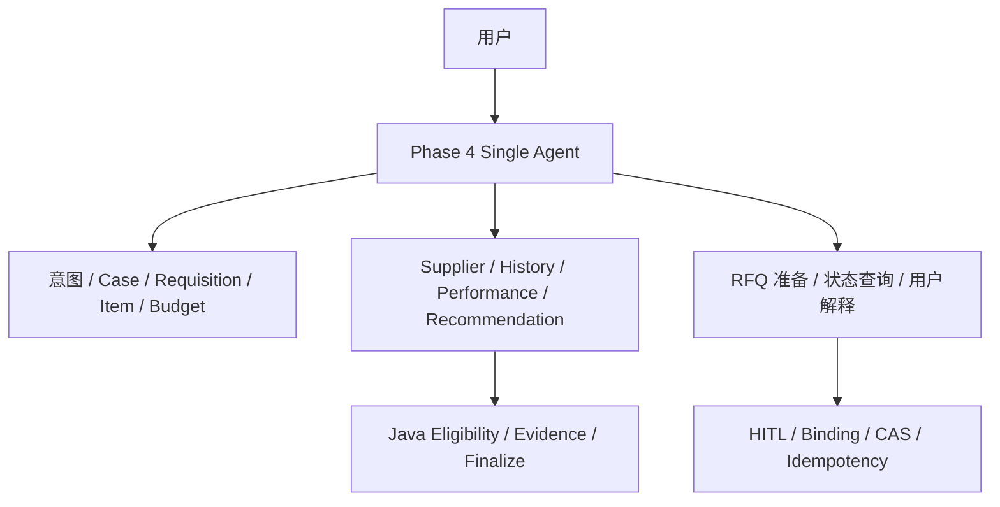
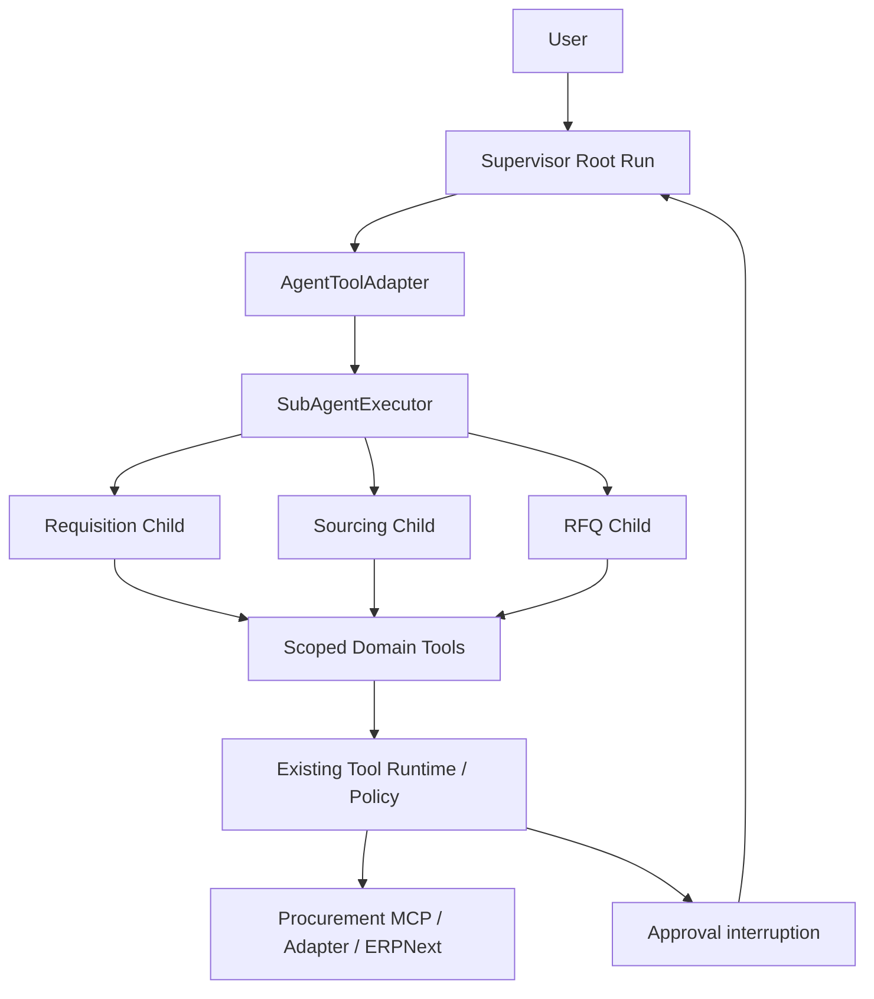

# Phase 6：Procurement Supervisor 与领域 Agent

> 最新 ANOM-01 恢复后单点验收：Runtime 正确拒绝两个 unsupported candidates，冻结 Business Grader PASS；Supervisor 最终文本又声明未经验证的预算硬阻断，Final-State Consistency / Acceptance v1.1 FAIL。唯一有效 trial 已保存，未修复或重跑。见 [phase6-anom01-infra-recovery-acceptance.md](phase6-anom01-infra-recovery-acceptance.md)。以下为历史记录。

> 最新 Blocker Candidate 修复：focused Java 88/88、Python 29/29、Legacy 全量 1273 PASS / 9 SKIP；唯一 ANOM-01 attempt 因 Docker Linux Engine 不可用在 reset 阶段失败，未调用模型，模型验收未完成。已停止且未重试。见 [phase6-blocker-candidate-acceptance.md](phase6-blocker-candidate-acceptance.md)。以下为历史记录。

> 最新 Acceptance v1.1：纠正 optional-path coverage 过度约束，旧 REQ-03 artifact 离线重评 PASS、旧 FAIL 保留；新增 ANOM-01 出现真实 CHILD_OUTPUT_INVALID / business FAIL 后停止。剩余 6 Smoke、Dev 未运行。见 [phase6-acceptance-v1.1.md](phase6-acceptance-v1.1.md)。以下为历史记录。

> 最新 Gate D1：新 REQ-01 四层 PASS；新 REQ-03 business/consistency PASS，但未调用 Requisition、无成功预算 receipt，按本次专项证据要求记录 acceptance coverage FAIL。已停止，其余 7 Smoke 与 Dev 未运行。见 [phase6-final-d-smoke.md](phase6-final-d-smoke.md)。以下状态保留历史语境。

> 当前最新结果：Root / Child Execution Scope 修复后唯一一次 REQ-01 business grader、Phase-6 acceptance 和 SupervisorFinalStateConsistency 均 PASS；已停止等待人工 Review，完整 Phase 6 Smoke / Dev 尚未通过验收。见 [phase6-execution-scope-acceptance.md](phase6-execution-scope-acceptance.md)。下列早期状态按历史时点保留。

> 最新最终源码验收：C1 在 REQ-01 发现 Supervisor 误将 Child 局部 executionFacts 解释为完整请求状态，离线验收 FAIL 后停止；冻结 grader PASS 保留，其他 Smoke / Dev 未运行。见 [phase6-final-acceptance.md](phase6-final-acceptance.md)。以下为历史记录。

> 最新第二次 Contract 修复：REQ-03 单次 frozen grader PASS，仍待人工 Review，未运行其余 Smoke/Dev。见 [phase6-contract-fix-acceptance.md](phase6-contract-fix-acceptance.md)。以下旧验收结果保留历史语境。

起点为 `procurement-context-v1` / `2f649d6cbc56cea1803ffa6e5a3561d48a53d776`，不包含 Phase 5 Selector。本文描述当前实现；最新 post-fix REQ-01 通过，但 REQ-03 失败，整套 Phase 6 尚未验收通过。最新结果见 [phase6-postfix-acceptance.md](phase6-postfix-acceptance.md)，历史实现记录见 [phase6-report.md](phase6-report.md)。

## 编码前职责审计

Phase 4 的 ProcurementSourcingExecutionProfileFactory 将用户意图、Case 补全、Item/Budget/Requisition 检查、Supplier/History/Performance 调查、Recommendation 和 RFQ 提议放在同一个模型上下文。ProcurementToolHandler 负责 Patch/Search/Finalize；Java Finalizer 负责硬约束、Eligibility 与 Evidence。ProcurementRfqApprovalPreparer 与 RFQ Handler/Gateway 负责 canonical request、审批、CAS、幂等与 ERP 写入。模型不能代替这些校验。

## 目标职责边界

| Agent | 工具职责 | 禁止能力 |
|---|---|---|
| Supervisor | inspect_procurement_case / analyze_requisition / source_suppliers / prepare_rfq | ERP 细粒度工具、直接 RFQ 写入 |
| Requisition | Case Patch、Item、Requisition、Budget、History | Supplier Performance、RFQ、Agent Tools、Memory |
| Sourcing | Supplier / Item / History / Performance、Search、Java Finalize | RFQ、Agent Tools、Memory |
| RFQ | 已验证推荐引用、Requisition / Supplier / RFQ 查询、原 RFQ 意图工具 | Case Patch、重新寻源、Agent Tools、Memory |

只拆三个有明确业务契约的领域。Commercial/Delivery 权衡由 Sourcing 承担，不增加二级 Worker。Supervisor 以 Agent-as-Tool 按需顺序委派；不 Handoff、不固定串行 workflow、不并行委派。

Task Packet 由服务器补齐身份、Case 与前序结果引用。模型只表达 objective，不能提供被信任的 run/tenant/version。Child 不继承 Root 时间线；Domain Result 只返回结构化结论、Evidence refs、warnings 和 child run ref，完整 Trace 留在原 Store。Phase 4 ContextAssembler/Projection/Compaction 算法保持不变。

Nested HITL 必须持久化同一个 Child Run、Approval 和 Pending Tool。Root 恢复时只恢复该 Child，继续 exact approved request，不重新创建 RFQ Agent 或 Proposal。Run 预算同时约束 Child 与 Root aggregate。

## 固定工具集合

以下 MCP 名称省略公共前缀 `mcp.erpnext.procurement_`。工具集合来自 AgentDefinition，不做阶段裁剪。原工具的 single-use 语义仍然适用，因此后续模型轮次的实际工具数可能减少。

| Agent | 初始工具数 | 具体工具 |
|---|---:|---|
| Supervisor | 4 | inspect_procurement_case、analyze_requisition、source_suppliers、prepare_rfq |
| Requisition | 7 | procurement_case_patch；get_requisition、list_requisitions、get_item、list_items、get_budget_status、get_purchase_history |
| Sourcing | 10 | procurement_supplier_search、procurement_recommendation_finalize；list_suppliers、get_supplier、list_item_suppliers、get_purchase_history、get_supplier_performance、get_item、get_requisition、get_budget_status |
| RFQ | 4 | procurement_create_rfq；get_requisition、get_supplier、get_rfq |

ToolRuntime 独立检查持久化 profile 的工具权限，程序化调用也必须通过。工具不可见本身不是授权。RFQ proposal 仍由原 Preparer 重建 canonical request，经 Approval Binding、HITL、Case CAS、Idempotency 和 ERP Gateway 执行；唯一新增许可是 RFQ Child 引用服务器绑定的同 Root Sourcing Finalize receipt。

## Task Packet 与返回契约

AgentTool 输入只允许 `objective`。服务端增加 `userGoal`、`caseId`、`caseVersion`、`constraints`、`priorResultRefs`；可用时附带已验证的 Requisition summary，RFQ 必须附带已绑定的 Finalize summary。身份、Root、Parent 和 Finalize receipt 均不可由模型指定；公共请求中的 `_domain*` metadata 被移除。

Child 模型返回公共严格对象：`status`、`findings[]`、`warnings[]`、`evidenceRefs[]`。Requisition 另外必须返回 `blockingReasons[]`、`deferredChecks[]`、`subjectRequisitionId`（新需求为空）、`departmentId`。适配器拒绝未知字段、非字符串数组、未知证据和缺少证据的成功结果。公共数组最大 40 项，单项最大 2000 字符。findings 是模型解释，不将它提升为权威业务事实。

| Domain | 状态与验证 | 服务器追加的结果 |
|---|---|---|
| Requisition | READY 要求权威 Case 完整；BLOCKED 必须有 canonical 事实支持的领域原因 | assessment（itemStatus / budgetStatus / duplicateStatus / caseComplete / 阻断与待办）以及 agentId、childRunId、caseVersion、objective、budget |
| Sourcing | COMPLETE 必须有成功 Java Finalize；NO_ELIGIBLE_SUPPLIER 必须有 Java Search 的空 eligible list 且无 Finalize | finalizationRef、精简 recommendation（supplier、价格/交期、evidenceRefs）及公共字段 |
| RFQ | COMPLETE 必须与真实执行 receipt 一致；拒绝后返回 REJECTED | executionStatus=CREATED / NOT_CREATED 及公共字段 |

Evidence refs 只能来自已成功工具的 evidenceId、canonical source tuple、持久化 tool-execution ref，或服务器绑定的 Finalize Evidence。完整 ERP 结果和 Child conversation 留在原 Tool/Timeline Store，Root 不接收它们。

Requisition 的阻断枚举仅包括 ITEM_INACTIVE、REQUISITION_CLOSED、BUDGET_UNAVAILABLE、DUPLICATE_REQUEST。Java 验证引用的原申购有成功精确读取；重复匹配使用当前 Case 的商品/数量、声明部门，排除原申购自身和关闭单据。不同数量只能是 advisory similarity。相同内容的新需求可与一个已有 ERP 请求构成重复。无观察结果只能报告 UNKNOWN / NOT_CHECKED，预算可用上限不等于报价已可行。

DELIVERY_FEASIBILITY、SUPPLIER_PERFORMANCE、SUPPLIER_PRICING 属于 Sourcing 待调查项目，不能被 Requisition 当作 BLOCKED 原因。Root 工具策略也拒绝在当前 Case version 已有确认阻断时进入 Sourcing/RFQ。该契约是首个 Smoke 失败后的架构修复；post-fix REQ-01 已通过，REQ-03 仍出现输出契约违规，不能声称真实模型在所有场景都已正确遵守。

## Parent/Child 与审批恢复

同一 Runtime 创建 Child；不引入第二套 RunStore 或模型循环。Child ID 从 Root ID + AgentTool call ID 确定性生成。持久化 metadata 提供 `rootRunId / parentRunId / callDepth`，runtimeState 中的 `agentId` 来自 profile。最大深度为 1。

RFQ Child 遇到审批时，其 pending RFQ request 和 Approval 由原实现保存。外层 AgentTool execution 保存为 WAITING_APPROVAL，Root 引用同一个 approvalId 并暂停。恢复 Root 时重入该 AgentTool，找到同一个 Child，调用原 `resume`；不会重新创建 Child 或 RFQ proposal。拒绝、过期、tampering、stale Case 均不能绕过原校验。直接请求恢复 Child 时，也先路由回 Root。

确定性验证使用真实 ToolRuntime / Preparer / Approval Guard 和模拟 gateway，覆盖暂停零写入、批准恰好一次写入、重复恢复零新增、拒绝、篡改/版本失效；过期等原有安全检查复用既有 RFQ 测试。序列化 Run/Tool records 后重建 Runtime 的测试覆盖恢复所需状态，但不是 PostgreSQL 进程重启验收。真实 ERP RFQ Nested HITL 尚未运行到对应 Smoke 任务。

## 预算、取消与失败

| Budget | Root aggregate | 每个 Child |
|---|---:|---:|
| turns / model calls | 80 / 80 | 24 / 24 |
| tool calls | 140 | 50 |
| input / output tokens | 1,500,000 / 50,000 | 384,000 / 16,000 |
| active duration | 480 秒 | 240 秒 |
| AgentTool calls | 最多 12 次 | 不允许 |

Child 消费同步计入 Root，操作前同时检查两层预算。审批等待暂停执行计时。同步 Child 执行期间 Root lease 覆盖 Root 剩余预算；Child 检查 Root 的持久化取消请求。Child 取消向 Root 返回 fatal child failure，Root 停止，不继续 RFQ。

CHILD_OUTPUT_INVALID、CHILD_RUN_FAILED、CHILD_RUN_BUDGET_EXCEEDED 均按 fatal outcome 传播；CHILD_WAITING_APPROVAL 按审批中断传播。合法性前置条件不满足返回 policy denied。相同 Root、领域、objective、Case version 的成功结果可复用，避免不必要模型调用；不是跨 Run Cache。

## Routing rubric

冻结任务没有独立 status-query 模型样本，因此该路径由确定性测试验证。评测 rubric 只判断 required/forbidden，允许多种合法顺序，不约束固定流程。

| Task outcome / type | Required | Forbidden | Optional |
|---|---|---|---|
| recommend | Sourcing | RFQ | Requisition |
| rfq（含审批拒绝/过期/篡改测试） | Sourcing、RFQ | 无 | Requisition |
| clarify / duplicate | 无 | Sourcing、RFQ | Requisition |
| blocked / bounded_failure | 无 | RFQ | Requisition、Sourcing |
| 独立状态查询（确定性测试） | 无 | 所有 Domain Agent | inspect core read |

`routing_errors` 是未调用 required 或调用 forbidden 的集合。`unnecessary_subagent_calls` 无可靠通用 rubric，报告 unavailable；不可用 0 替代。预算上限与同版本结果复用另外报告。

## Context、Trace 与比较口径

每个 Agent 使用独立的 Phase 4 ContextPolicy；Child 只加载自己的时间线和重新读取的 canonical Case。Supervisor 保留用户会话，Domain 不写长期 Memory。ContextAssembler、ToolResultProjector 和 Compaction 算法未优化。

Trace 复用原 Store，记录 Parent/Child linkage、Root 的 SUB_AGENT_STARTED/COMPLETED、Child model/tool events 以及审批中断。派生 metrics 包含子调用数/分布、Child turns/tools/tokens/failures、Supervisor tokens。评测 artifact 保存所有 Root/Child Run 和 events。

主比较对象仅为 Phase 4 Single Agent。应同时报告 Root peak、Child peak、overall max 和所有 Provider tokens；guardrail tokens 保留在冻结总量中，但不强行分配为 Root/Child。提示词与预算因职责拆分发生变化，单次 Dev 对比不能解释为 Multi-Agent 的稳定因果收益。工具空间减少不等于总成本减少。

## 第二次 Contract 修复：Canonical References / Evidence / Execution Facts

本轮仅修复领域边界，不扩展 Agent 能力。验收预算仅 REQ-03 × 1；旧失败永久保留于 `evals/multi-agent/reports/contract-fix/pre-contract-REQ03.zip`，此前 post-fix artifacts 原位不变。

- `TaskPacket.businessRefs`：Case ID / 已确定 item ID 来自当前 canonical Case；department ID 来自 MCP budget tool schema 的 `x-businessRefs`，由现有服务端 deployment mapping 生成；已有 subject requisition 来自之前精确读取并通过验证的 assessment；RFQ supplier 来自服务器绑定的 Finalize。尚未确定的 Item / Requisition / Supplier 保持合法发现，不从用户文本自动提取或构造 canonical ID。
- 当前 canonical 模型没有 costCenterId，packet 明示 `UNSUPPORTED_BY_CANONICAL_MODEL`。部门映射缺失时 budget 调用返回 `MISSING_CANONICAL_REFERENCE` / `VALIDATION_ERROR`。未建立 Case 时不提前构造 Case ID。
- 保留既有 MCP tool input；`ChildBusinessScope` 在能力分发前，将模型参数与持久化 Child TaskPacket 对照。已绑定 ID 不匹配返回 `CANONICAL_REFERENCE_MISMATCH` / `VALIDATION_ERROR`，失败记录留在执行 store，不触达 ERP。
- `ChildEvidenceLedger` 是现有执行记录的派生视图。只有 `SUCCEEDED` + `ToolExecutionOutcome.SUCCESS` + 可识别 canonical 结构的结果产生正面 evidence；保留 reference、tool-call ID、tool name、outcome、entity/version 和 canonical facts。失败记录仍在 Trace，不进入 positive ledger。
- 子输出 evidenceRefs 逐项校验当前 child ledger。唯一已有跨 Child 通道是 RFQ 对同 Root 下服务器绑定的成功 Finalize，且 packet 必须显式授予 `priorEvidenceRefs`；不因为同属 Root 就共享其它私有引用。
- Child 仍输出紧凑 JSON 分析，可附 `proposedCaseChanges` 字符串数组；Runtime 返回分层的 `analysis`（结构与引用已验证，但文本不是写入权威）、`proposals`（未提交）、`executionFacts`（仅回执与存储派生）和 `canonicalCase`。未知额外字段如 `casePatched` 不被模型输出合同接受。自然语言不做虚假的语义真值保证。
- `executionFacts.casePatched` 必须同时有成功 Patch 回执、匹配 Case ID / version 和 `appliedInputIds`。RFQ fact 来自成功的原审批绑定 Gateway 回执；本轮未新增 approvalRecorded 自由布尔字段或新持久化系统。
- `status` 的 constrained schema 与 Runtime 允许值均为 READY / COMPLETE / BLOCKED / NEEDS_CLARIFICATION / NO_ELIGIBLE_SUPPLIER / REJECTED；blockingReasons 与 deferredChecks 继续使用既有有限枚举。schema 随 AgentDefinition 传入 Child profile，Runtime 继续确定性拒绝 unknown enum / field / evidence，不新增修复循环。
- 原有 blocker / downstream 边界保持：交付可行性、绩效、价格调查仍归 Sourcing。本轮最小 instruction 更新只同步通用 contract，没有任务 ID 或部门 ID 特例。

## Root / Child execution scope contract（替代上一版 executionFacts envelope）

`ProcurementExecutionSummaries` 直接派生已有 ToolExecutionStore 中的成功回执；没有新建业务存储或 lastChildResult 共享布尔值。

- Child Result 的 `childExecutionSummary.scope=CHILD_LOCAL`，绑定 childRunId / agentId。caseMutated、caseMutationCount、resultingCaseVersion 只描述该 Child 的成功 Case mutation；没有 mutation 时 resultingCaseVersion=-1，不能用它代表当前 Case version。
- `rootExecutionSummary.scope=ROOT_GLOBAL` 按当前 Root 的 AgentTool execution 定位并校验持久化 Child lineage，合并所有成功 canonical receipts。即使 Child 后续失败或暂停，之前已成功提交的 mutation 仍保留。ANY 决定 caseMutated，去重 toolCallId 后的回执数决定 caseMutationCount。
- Root currentCaseVersion 从当前 Case Store 读取，不取模型报告版本，也不取 Child 版本最大值。root.rfqCreated 只由成功、审批绑定的原 Gateway receipt 支持；proposal/WAITING_APPROVAL 不算 RFQ。
- Root/Child summary 只带有限标量、最多 8 个 receipt refs 和 omittedReceiptRefs；完整回执留在原执行存储，不重塞整个 ledger 进模型 Context。
- Supervisor 每次收到 Child 结果，可区分 validated analysis、proposals、childExecutionSummary、rootExecutionSummary、canonicalCase；inspect 同样返回 root summary。重用旧领域结果时刷新 root summary 与当前 canonical Case。
- `AgentRuntimeResult.answer` 保留模型原文；新增 `serverFacts.rootExecutionSummary` 与 `serverFacts.businessResult` 提供服务端事实。terminal / approval / pause Trace 同时带 serverFacts，恢复/重复读取从持久化记录重建，不依赖进程内布尔值。未改 UI。
- Supervisor 的通用 contract 指令要求对整个请求状态只使用 root summary + canonical state；没有任务或 true/false 组合专用提示。
- Phase 6 的独立 `SupervisorFinalStateConsistency` 先验证结构化 summary 与成功回执/Case 一致，再要求明确的原文行为复查。元数据正确不会自动使错误解释通过；不采用关键词 NLP 或 LLM Judge，不改 frozen V2.2 grader，不引入自动修复循环。
