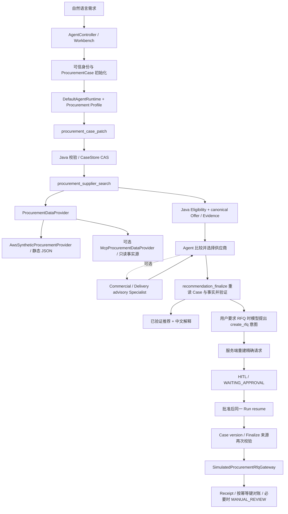

# Procurement V0：Legacy Regression Baseline

审计日期：2026-10-02（Asia/Shanghai）。生产源码基点：`2e9676afef5b7af1cb887760c608337c92e7c9c7`，分支 `main`。开始审计时工作区不 clean：`ProcurementToolHandler.java` 已有 12 行注释增量，本阶段保留，未改变其内容。本次冻结新增文件尚待人工 Review 和提交；不能把该 SHA 说成包含本次文档和脚本的提交。

这里的 V0 是现有采购能力的 **Legacy Regression Baseline**。`legacy-v1` 是回归套件目录版本，不代表 Procurement V1。本基线不是未来 Harness 提升的正式 B0；后者须在 ERPNext + Procurement V2 + Eval V2 建立后重新运行。

## 1. 当前业务流程与入口



入口与代码索引（链接均为仓库实际文件）：

| 边界 | 实现与作用 |
| --- | --- |
| 直接运行 API | [AgentController](../src/main/java/com/agent/platform/web/AgentController.java)：`POST /api/agent/runs`，含 JSON/SSE；`/runs/{runId}/resume` 恢复 |
| 公开采购策略 | [PublicProcurementRunPolicy](../src/main/java/com/agent/platform/web/PublicProcurementRunPolicy.java)：可信 principal、conversation 所属权、采购 Profile、Case 初始化；客户端 metadata 不作为执行授权 |
| Workbench | [UnifiedWorkController](../src/main/java/com/agent/platform/workbench/web/UnifiedWorkController.java)：`POST /api/agent/conversations/{conversationId}/inputs`；确认路由后经 [ProcurementSourcingExecutionAdapter](../src/main/java/com/agent/platform/workbench/dispatch/ProcurementSourcingExecutionAdapter.java) 分发 `PROCUREMENT_SOURCING` |
| Agent 执行 | [RuntimeAgentExecutor](../src/main/java/com/agent/platform/agent/RuntimeAgentExecutor.java) → [DefaultAgentRuntime](../src/main/java/com/agent/platform/runtime/DefaultAgentRuntime.java)；[ProcurementSourcingExecutionProfileFactory](../src/main/java/com/agent/platform/procurement/config/ProcurementSourcingExecutionProfileFactory.java) 定义现有 Prompt、工具白名单和预算 |
| 核心工具 | [ProcurementToolCatalog](../src/main/java/com/agent/platform/procurement/tool/ProcurementToolCatalog.java)、[ProcurementToolHandler](../src/main/java/com/agent/platform/procurement/tool/ProcurementToolHandler.java)：Patch、Search、Finalize |

当前 Profile 有三个核心工具、两个可选 Specialist capability 和一个审批绑定的 RFQ capability。它并不是未来 Supervisor + Requisition/Sourcing/RFQ 三个领域 Agent 的架构。

## 2. Case 与状态模型

[ProcurementCase](../src/main/java/com/agent/platform/procurement/model/ProcurementCase.java) 保存 `caseId/tenantId/userId/conversationId/status/state/createdAt/updatedAt/version/lastAppliedInputId/appliedInputIds`。可信身份来自 Runtime；Case 按 tenant + user + conversation 查找。

[ProcurementCaseState](../src/main/java/com/agent/platform/procurement/model/ProcurementCaseState.java) 保存商品类别/描述、数量、预算、币种、交期、硬约束、偏好、排除供应商、`missingFields/currentPhase`。Agent 只能通过 [ProcurementCasePatch](../src/main/java/com/agent/platform/procurement/model/ProcurementCasePatch.java) 提交允许的字段更新、集合增删和受控标量清除；身份、版本、派生字段不在模型 Patch 协议中。

[ProcurementCaseService](../src/main/java/com/agent/platform/procurement/application/ProcurementCaseService.java) 和 [ProcurementCasePatchMerger](../src/main/java/com/agent/platform/procurement/application/ProcurementCasePatchMerger.java) 负责校验、合并、派生状态。[JdbcProcurementCaseStore](../src/main/java/com/agent/platform/procurement/persistence/JdbcProcurementCaseStore.java) 使用与 Runtime 共用的 storage datasource，持久化到 `procurement_case_state`，SQL 以 version 为条件更新。

**状态声明与实际写入需要区分**：枚举有 `CLARIFICATION_REQUIRED/SOURCING/RECOMMENDATION_READY/NO_ELIGIBLE_SUPPLIER`，但当前 CaseService 根据缺失字段写前两种状态；Search 和 Finalize 不保存后两种状态。Finalize 的推荐通过工具结果/ToolExecutionRecord 留存，不是 Case 内持久化的独立推荐对象。不能只凭枚举宣称完整采购状态机已落地。

[ProcurementCaseContextRenderer](../src/main/java/com/agent/platform/procurement/application/ProcurementCaseContextRenderer.java) 为每个模型轮次重读权威 Case，交由现有 Context Manager 注入 canonical business context。Case 与动态报价不由长期 Memory 充当权威来源。本次不改 Context、Memory 或 Runtime。

## 3. 当前数据来源：静态 synthetic business world

| 文件/组件 | 真实作用 |
| --- | --- |
| [01_suppliers.json](../data/procurement/aws-synthetic/01_suppliers.json) | AWS sample synthetic supplier base，仅作 fallback discovery；来源声明见同目录 [README](../data/procurement/aws-synthetic/README.md) |
| [complex_workstation_01.json](../data/procurement/scenarios/complex_workstation_01.json) | 项目自己的工作站场景，含 A/B/C/D 供应商、报价、交期、质保和规格；`sourceAsOf=2026-01-01T00:00:00Z`。不是 AWS 原始报价，也不是实时业务系统 |
| [AwsSyntheticProcurementProvider](../src/main/java/com/agent/platform/procurement/provider/AwsSyntheticProcurementProvider.java) | 商品类别/描述包含 `cuda`、`workstation` 或 `工作站` 时尝试读取配置的 scenario；不存在或未选择时退回 supplier base，fallback 没有 supplier offer（返回空列表） |
| [ProcurementDataProperties](../src/main/java/com/agent/platform/procurement/config/ProcurementDataProperties.java) | 默认 `provider=synthetic`、`scenarioDir=data/procurement/scenarios`、`scenarioFile=complex_workstation_01.json`；本次未改配置 |
| [McpProcurementDataProvider](../src/main/java/com/agent/platform/procurement/provider/McpProcurementDataProvider.java) | 已有可选只读 Provider 后端，读取 `mcp.procurement.search_suppliers/get_offers`，验证 canonical 响应，不自动回退 synthetic；真实 ERP 集成未由此证明 |
| [FakeProcurementMcpServerApplication](../src/test/java/com/agent/platform/procurement/FakeProcurementMcpServerApplication.java) | 测试 child JVM stdio MCP server，同样读取现有 scenario；证明协议/集成路径，不代表真实 ERP |

Scenario 是当前 Runtime 事实源：Provider 每次通过 `Files.readString/readTree` 读取，构造 `SupplierCandidate/SupplierOffer/SupplierEvidence`。单价来自 JSON，总价按 Case 数量计算。主 Agent 通过 Search/Finalize 的结构化 ToolResult **间接消费该文件**，并不直接打开文件。Specialist 消费从成功 Search 中筛选的事实。Benchmark 的 expected answer 不注入生产 Agent。

示例在 50 台、预算 600000 CNY、21 天、显存至少 24GB、排除 A 时：B 为 550000/18 天，D 为 580000/12 天；两者 eligible，交付优先选择 D、价格优先选择 B。A 被排除且交期不符，C 显存 16GB 不符。若交期改为 14 天，B 也会被硬约束拒绝，不能继续称其 eligible。

当前磁盘只有一个业务 scenario。测试 [benchmark-v1](../src/test/resources/procurement/benchmark/procurement-benchmark-v1.json) 复用该世界定义四个 Case：交付优先、价格优先、单一 eligible、无 eligible；[answer-policy-v1](../src/test/resources/procurement/evaluation/procurement-answer-policy-v1.json) 保存必答元素及资源字节哈希。测试内另有 handcrafted、mutated、scripted fixture，不应当作额外真实业务数据。

## 4. 推荐与已存在的 Specialist

[ProcurementDecisionEngine](../src/main/java/com/agent/platform/procurement/application/ProcurementDecisionEngine.java) 仅计算 Eligibility：币种、预算、交期、排除项、当前支持的 `gpuMemoryMinGb` 硬约束；不评分、不排序、不自动选供应商，未知硬约束拒绝。开放式 trade-off 由 Agent 完成。

Agent 提交 `evaluatedCaseVersion/selectedSupplierId/evidenceRefs/tradeoffDimensions/confidence`。[ProcurementRecommendationFinalizer](../src/main/java/com/agent/platform/procurement/application/ProcurementRecommendationFinalizer.java) 重读 Case、候选、Offer 和 Evidence；版本过期、需求未完整、选择不 eligible、证据不合法均拒绝。Java 构造 canonical 推荐事实，包括选中报价、eligible alternatives、拒绝项和 matched constraints；模型不能提交这些事实的替代值。confidence 是主观决策 metadata，不是正确率。

[ProcurementSpecialistToolHandler](../src/main/java/com/agent/platform/procurement/tool/ProcurementSpecialistToolHandler.java) 与 [ProcurementSpecialistProfileFactory](../src/main/java/com/agent/platform/procurement/config/ProcurementSpecialistProfileFactory.java) 已存在。Commercial 关注价格/预算/质保，Delivery 关注交期/期限余量；使用已有 SubAgentRunner，隔离 child Run/Session，无工具、关闭长期记忆，不继续委派。输入取当前 Run、当前 Case version 的成功 Search，简单单候选场景拒绝无必要委派。输出校验 `focus/summary/supplierIds/evidenceRefs/limitations`，只是 advisory，不写 Case、不调用 Provider、不生成 Evidence、不选择最终供应商。Finalizer 仍是主 Agent 必须经过的验证步骤。

## 5. 已存在的确定性安全机制

| 机制 | 实际行为与边界 |
| --- | --- |
| Case/version/CAS | Patch 以当前版本执行 `UPDATE ... WHERE version=?`；冲突不静默覆盖。Finalize 校验 evaluated version，RFQ 再校验 prepared version。不是跨所有步骤的单个数据库事务 |
| Patch 幂等 | Runtime tool request ID 作为 input ID，命中 `appliedInputIds` 返回当前 Case，不重放旧 Patch；集合最多 128 项，不能声称无限期去重或严格时间有序淘汰 |
| Evidence/Provenance | [EvidenceIdFactory](../src/main/java/com/agent/platform/procurement/model/EvidenceIdFactory.java)、[SupplierEvidence](../src/main/java/com/agent/platform/procurement/model/SupplierEvidence.java)、[SupplierOffer](../src/main/java/com/agent/platform/procurement/model/SupplierOffer.java) 绑定来源、记录、snapshot、as-of、digest 和 fact；Java 验证 provenance 与 ID。它证明内部一致性，不证明 synthetic 事实在真实世界中为真 |
| Recommendation Finalization | [Verifier](../src/main/java/com/agent/platform/procurement/application/ProcurementRecommendationVerifier.java) 要求当前 Evidence 集中的引用、selected supplier OFFER；多个 eligible 时要求备选 OFFER 和非空受限 tradeoff dimensions。自由中文解释不等于 canonical 事实验证 |
| HITL / Approval Binding | `procurement_create_rfq` 为 HIGH 副作用能力。[ProcurementRfqApprovalPreparer](../src/main/java/com/agent/platform/procurement/tool/ProcurementRfqApprovalPreparer.java) 丢弃模型 proposal 中的业务字段，用可信身份、当前 Case 和本 Run 成功 Finalize 重建 11 字段 exact request；`idempotencyKey=rfq:<approvalId>`。批准前 create=0 |
| 受批动作执行 | [DefaultAgentToolRuntime](../src/main/java/com/agent/platform/runtime/DefaultAgentToolRuntime.java) 负责 APPROVED 与存储请求绑定。[ProcurementRfqToolHandler](../src/main/java/com/agent/platform/procurement/tool/ProcurementRfqToolHandler.java) 再验 Case、Finalize 来源、supplier 和精确 payload；handler 本身不重新查询 ApprovalService |
| RFQ Receipt / 去重 | [SimulatedProcurementRfqGateway](../src/main/java/com/agent/platform/procurement/tool/SimulatedProcurementRfqGateway.java) 用 ConcurrentMap 按幂等键保存 receipt，`computeIfAbsent`；仅当前 JVM 生命周期内有效 |
| Resume / Recovery | Runtime 保存 WAITING_APPROVAL，批准后同一 Run 执行原请求；tool claim 和缓存结果防重复调用。RUNNING 崩溃窗口由已注册的 UncertainToolExecutionResolver 查询幂等键，绝不盲目重放 create |
| 不确定副作用 | 一旦进入 gateway create，异常后只 findByIdempotencyKey；receipt 匹配则成功，否则 `manualReview=true/retryable=false/uncertainExternalState=true`。业务“查不到”不能当作可安全重试 |
| Trace | Runtime Timeline 的 AgentEvent、ToolExecutionRecord、run/session/childRunId、attempt、budget、resumeCount；`AgentController` events 和 [ToolController](../src/main/java/com/agent/platform/web/ToolController.java) executions 可读，RuntimeAgentExecutor 从 events 投影 TraceSummary。现有 `/traces` 是共用能力，不能把接口存在当作已验证的独立全链路 trace 持久化证明 |

RFQ 的当前副作用是 **simulated execution**。没有真实供应商邮件、ERP RFQ、PO、合同或付款。进程重启会丢失模拟 Gateway receipt，故不能证明跨进程 exactly-once；这不否定现有审批、单进程去重和不确定结果对账的自动化覆盖。

## 6. Fixture 冻结、回归入口与回滚定位

保留原路径、原字段和原业务数据，不搬动 fixture。[fixtures.json](../evals/regression/legacy-v1/fixtures.json) 固定现有五个资源的 SHA-256（UTF-8/LF 原始字节）。[.gitattributes](../.gitattributes) 固定采购数据与测试资源为 LF；这是本轮唯一稳定性配置修复。原因是 Windows `core.autocrlf=true` 使原 Policy 哈希不匹配，详见 [测试报告](baselines/procurement-v0-test-report.md)。没有改写 Policy 中的冻结哈希。

统一入口、10 项行为的测试映射及环境要求见 [Legacy Suite README](../evals/regression/legacy-v1/README.md)。默认执行采购测试、显式 artifact replay、构建；`-FullSuite` 执行全仓 Java 测试，`-Live` 才调用真实模型，`-Postgres` 才打开真实数据库 IT。默认环境门控跳过必须保留为 skip，不等于通过。

后续比较时保留相同 fixture、Case、Prompt/模型/configuration、评分器版本和分母，并区分 scripted / handcrafted / live。正式 Comparator 必须先通过 `ProcurementComparisonInputs.validate` 的整体 COMPARABLE 门禁；不可将任意 JSON PASS 相加。V0 的测试断言通过率也不是业务任务成功率。

回滚代码基点为上述完整 SHA。当前未创建 Git commit/tag，也未 push；人工 Review 后可用本次最终提交作为包含文档/脚本的冻结点。无需破坏当前工作区即可提取原实现：

```powershell
git show --no-patch 2e9676afef5b7af1cb887760c608337c92e7c9c7
git archive --format=zip --output=../enterprise-agent-v0-source.zip 2e9676afef5b7af1cb887760c608337c92e7c9c7
```

解压到独立目录并以 LF 恢复冻结资源；该旧 SHA 不包含本轮 `.gitattributes` 修复，比较时需带上已 Review 的回归文件。不要用 reset/restore 覆盖当前改动。代码定位不等于数据库回滚：Runtime/Approval/Case DB 应独立备份，模拟 receipt 无跨进程恢复能力。

## 7. V0 限制与未来边界

- 业务事实主要覆盖一个静态工作站场景，fallback supplier discovery 不提供报价；不能据此宣称通用品类采购覆盖。
- 已有可替换的只读 MCP Provider 与真实 stdio 测试；当前证据未证明接入真实企业主数据系统。
- Specialist 是已存在的辅助分析能力，不能把其存在夸大为完整 Requisition → Sourcing → RFQ Agent 分工，也不能写成完全没有子 Agent。
- 硬约束 vocabulary 有限；Finalizer 验 canonical 推荐而非全部自然语言回答。回答完整性需单独 Eval。
- Benchmark 主要是同一静态 sourcing 场景的四种需求；RFQ 审批与副作用通过独立测试保护，不在 Live Benchmark 四 Case 的成功率分母中。
- 真实 ERP latency、跨进程 exactly-once、生产任务成功率、模型质量提升和统计显著性当前不可由 V0 证明。
- 本次实际通过、失败、跳过与未验证项目只以 [测试报告](baselines/procurement-v0-test-report.md) 为准。未来方案单独见 [V2 总升级方案](procurement-v2-upgrade-plan.md)，本阶段不实现。
